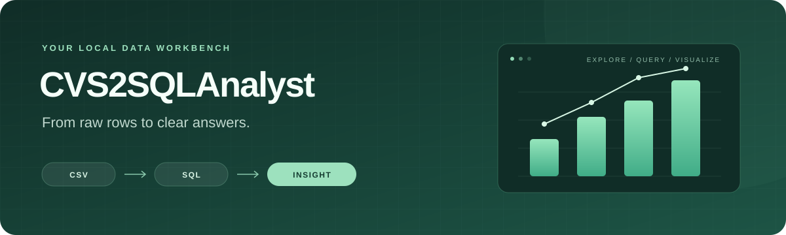

<p align="center">
  
</p>

<p align="center">
  <strong>Upload a CSV. Ask a question with SQL. Find the pattern.</strong><br>
  A local data workbench powered by Streamlit, DuckDB, pandas, and Plotly.
</p>

<p align="center">
  <a href="#quick-start">Quick start</a> ·
  <a href="#workspace-tabs">Workspace tabs</a> ·
  <a href="#your-first-analysis">Your first analysis</a> ·
  <a href="#exports">Exports</a> ·
  <a href="#development">Development</a>
</p>

---

## Why CVS2SQLAnalyst?

Explore a spreadsheet-sized dataset without setting up a database server. Import a file, inspect its structure, run SQL, and turn your results into a chart—all in one browser workspace.

- **Bring your own data** — UTF-8 CSV imports with delimiter detection and inferred column types.
- **Get answers with SQL** — DuckDB queries, CTEs, and shortcuts for previews, counts, and grouped totals.
- **Check and clean your data** — column profiles, missing-value reports, duplicate detection, and cleaning previews with original-data restore.
- **See the pattern** — interactive bar, line, and scatter charts with their source query attached.
- **Take your work with you** — CSV results, full-table SQL scripts, and standalone HTML charts.
- **Keep it local** — session-specific data held in memory by the Python server.

> The app starts empty. Your data appears only after you import a CSV or explicitly choose **Load sample data**.

##  Live Demo

- **Deployed Dashboard**: [https://csv2sqlanalyst.streamlit.app](https://csv2sqlanalyst.streamlit.app)


## Quick start

You need **Python 3.11+** and [uv](https://docs.astral.sh/uv/). From the project folder:

```sh
uv sync
uv run streamlit run app.py --server.address 127.0.0.1 --server.port 8766
```

Open **[localhost:8766](http://127.0.0.1:8766)**. Stop the server with `Ctrl+C`.

**On macOS:** after installing uv, double-click [`run.command`](run.command) to launch the app.

<details>
<summary><strong>Prefer pip? Use a virtual environment</strong></summary>

```sh
python3 -m venv .venv
source .venv/bin/activate
python -m pip install "streamlit>=1.66,<2" "duckdb>=1.4,<2" "pandas>=2.2,<4" "plotly>=6,<7"
python -m streamlit run app.py --server.address 127.0.0.1 --server.port 8766
```

On Windows, use `.venv\Scripts\activate` to activate the environment.

</details>

## Workspace tabs

Your workspace has five tabs, each focused on a different part of the analysis:

- **Overview** — preview your dataset and inspect any column's summary statistics, missing percentage, distinct count, and ten most common values.
- **SQL Lab** — filter, sort, group, and aggregate data with DuckDB SQL. Review the last successful results here.
- **Visualize** — build bar, line, and scatter charts from those SQL results, with the source query attached.
- **Data Quality** — see missing values per column, duplicate rows, and fully empty rows. Preview cleaning changes before applying them.
- **Exports** — download query results, your full current dataset, a SQL table script, an offline chart, or the column quality report.

Tabs are visible even before import, with guidance on how to get started.

## Your first analysis

### Bring in a file

Choose a CSV in the sidebar, set a table name, and click **Import CSV**. The schema, row count, and missing-cell count appear once your file is loaded.

Want to try it first? Click **Load sample data**, or upload [`examples/sample_sales.csv`](examples/sample_sales.csv).

Files must be UTF-8 and no larger than **25 MB**. Comma, semicolon, tab, and pipe delimiters are detected automatically. Table names accept letters, digits, and underscores, and must begin with a letter or underscore. Importing a new file replaces the current table.

### Ask a question

With the sample dataset loaded, paste this into the SQL editor and click **Run query**:

```sql
SELECT
    region,
    SUM(revenue) AS total_revenue,
    SUM(units) AS total_units
FROM dataset
GROUP BY region
ORDER BY total_revenue DESC;
```

Use your chosen table name instead of `dataset` for an uploaded file. You can also use **Preview rows**, **Count rows**, or **Group & summarize** to get started.

> **SQL tip:** quote column names containing spaces, such as `"Order Total"`. Use `CAST` or `TRY_CAST` to adjust inferred types. Each run accepts one read-only `SELECT` or `WITH` query; failed queries preserve the previous successful results.

### Find the pattern

In **Visualize**, select a chart type, an X axis, and a numeric Y axis. Charts use the last successful query, and its SQL appears below the visualization.

Line charts sort the X axis. Bar charts display individual result rows, so aggregate with `GROUP BY` in SQL when you want totals.

### Clean with a preview

Open **Data Quality** to inspect your dataset before making changes. You can:

- Trim surrounding text whitespace and treat blank strings as missing.
- Remove fully empty rows.
- Fill one column's missing values with its most frequent value, mean, median, or zero. Mean, median, and zero require a numeric column.
- Remove duplicate rows after filling.

The preview shows the remaining rows and missing cells. **Apply cleaning** updates the full dataset, then refreshes SQL results and charts to a 100-row preview. **Restore original dataset** brings back the data from the latest import or explicit sample load. Importing another file replaces this restore snapshot.

Cleaning runs in this order: trim text, remove empty rows, fill missing values, then remove duplicates. If a change would remove every row or use an incompatible fill method, it is rejected. When multiple values tie for most frequent, the first mode is used.

## Exports

All downloads are in the **Exports** tab:

- **Results → CSV:** download the displayed query results with **Export results CSV**.
- **Chart → HTML:** save an interactive chart, including Plotly, for offline viewing. The chart toolbar also exports PNG images.
- **Full dataset → CSV:** download every row in the current dataset, including applied cleaning changes.
- **Data quality → CSV:** save column types, missing-value counts and percentages, and distinct-value counts.
- **Full table → SQL:** choose **Download SQL table**. The script includes every imported row as DuckDB-compatible `CREATE TABLE` and `INSERT` statements.

## Know the limits

**25 MB per upload · 10,000 result rows · 1,000 chart rows · 100 preview rows**

Query-result CSV exports follow the result limit; full-dataset CSV and SQL exports include the entire current dataset. Aggregate larger datasets in SQL before charting them.

Each query has a 10-second timeout, a 512 MB DuckDB memory limit, and two execution threads. Table-changing statements and DuckDB filesystem/network access are disabled. These controls are intended for local use; public multi-user hosting has not been validated.

Data lives in a separate in-memory workspace for each browser session. Widget interactions preserve your workspace; refreshing the browser starts a new session. Download anything you want to keep before refreshing or closing the app.

The current app supports one imported table at a time. It does not include accounts, saved dashboards, persistent storage, or joins across uploaded files.

## Development

The repository keeps the interface, data engine, examples, and documentation separate:

```text
.
├── app.py                    # Streamlit interface and session workflows
├── cvs2sqlanalyst/
│   ├── __init__.py
│   ├── analysis.py           # Column profiles and non-mutating cleaning
│   └── engine.py             # CSV parsing, constrained SQL, and SQL export
├── .streamlit/
│   └── config.toml           # Theme and upload limit
├── examples/
│   └── sample_sales.csv
├── docs/
│   ├── assets/banner.svg
│   └── verification.md
├── tests/
│   ├── test_analysis.py
│   ├── test_app.py
│   └── test_engine.py
├── pyproject.toml            # Dependencies and test configuration
├── uv.lock                   # Locked dependency versions
├── run.command               # macOS launcher
└── README.md
```

Run the checks:

```sh
uv sync
uv run pytest -q
```

Tests cover CSV imports, SQL restrictions, aggregates, session isolation, result limits, exports, chart controls, empty startup, sample-data loading, cleaning previews, original-data restore, and quality reports. See [verification notes](docs/verification.md) for validation details.
